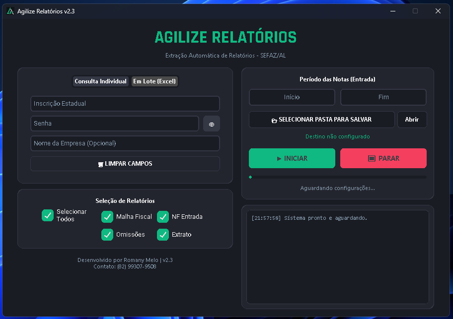

# Agilize Relatórios

**Automação de extração de relatórios fiscais de portais da Fazenda.**

Aplicação desktop em Python que autentica no portal do contribuinte, emite os relatórios fiscais de uma carteira inteira de empresas e salva tudo em PDF, organizado por empresa — em lote, a partir de uma planilha Excel. Em produção, roda contra o portal da SEFAZ/AL em um escritório de contabilidade.


> **Edição pública.** Este repositório traz o projeto completo com uma exceção: o adaptador que conversa com o portal da SEFAZ/AL não acompanha o código, por ser o núcleo comercial do produto. A interface que ele implementa está documentada em [portal/README.md](portal/README.md), com um exemplo funcional. Tudo o mais — interface gráfica, orquestração do lote, captura de PDF, tratamento de erro — está aqui por inteiro, e a aplicação abre e roda normalmente.

---

## O problema

Escritórios de contabilidade precisam acompanhar a situação fiscal de cada empresa cliente no portal da Fazenda. Para **uma** empresa, o processo manual é:

1. Abrir o portal e fazer login com a Inscrição Estadual e senha
2. Navegar até a área de relatórios
3. Emitir cada relatório, aguardar o pop-up, salvar o PDF
4. Repetir em outros sistemas do mesmo portal, cada um com seu próprio login
5. Sair e recomeçar para a próxima empresa

Multiplicado por dezenas de clientes, todo mês. Este projeto transforma isso em: importar a planilha, marcar o que quer, clicar em Iniciar.

## Demonstração



A janela principal: à esquerda os dados da empresa e a seleção de relatórios, à direita o período, o destino e o log em tempo real. O botão Iniciar só habilita quando há destino, período válido e pelo menos um relatório marcado.

## Funcionalidades

- **Quatro relatórios** em uma única execução: Malha Fiscal, Notas Fiscais de Entrada (com filtro por período), Omissões de entrega e Extrato de Pendências
- **Dois modos de operação:** consulta individual ou processamento em lote via planilha Excel
- **Nomeação automática** dos arquivos — `{Empresa}_{IE}_{Relatório}.pdf`, salvos na pasta escolhida
- **Planilha de status** gerada ao final do lote, marcando cada empresa como `Sucesso` ou descrevendo o erro encontrado, para que nenhuma falha passe despercebida
- **Log em tempo real** e barra de progresso com granularidade por empresa e por relatório
- **Parada segura:** o sinal de interrupção é verificado entre cada passo, sem deixar o navegador órfão
- **Captura de PDF resiliente:** quatro estratégias em cascata, porque o portal entrega o arquivo de formas diferentes conforme o módulo
- **Máscaras de entrada** para Inscrição Estadual e datas, com o botão Iniciar habilitado apenas quando tudo está preenchido
- **Controle de acesso** por usuário e senha, com vínculo da licença a um único computador (HWID) e data de expiração

## Arquitetura

```
┌──────────────────┐
│   Tela de Login  │  valida credenciais no Supabase
│  (CustomTkinter) │  + trava de HWID + data de expiração
└────────┬─────────┘
         │
┌────────▼─────────┐
│  App Principal   │  lê a planilha com pandas → lista de empresas
│    (interface)   │
└────────┬─────────┘
         │ threading.Thread (mantém a UI responsiva)
┌────────▼─────────┐
│   Orquestração   │  Chromium headless, um contexto isolado por empresa
│                  │
│                  │   para cada empresa:
│                  │     adaptador.autenticar(page, ie, senha)
│                  │     para cada relatório:
│                  │       pagina = adaptador.emitir(...)
│                  │       captura_pdf.salvar(context, pagina, destino)
└────────┬─────────┘
         │
┌────────▼─────────┐
│  PortalAdapter   │  interface: autenticar / listar_relatorios / emitir
│    (portal/)     │  implementação da SEFAZ/AL não incluída
└────────┬─────────┘
         │
┌────────▼─────────┐
│      Saída       │  PDFs por empresa + Resultado_Agilize_{data}.xlsx
└──────────────────┘
```

Detalhes de implementação que valem nota:

- **Isolamento por empresa:** cada cliente roda em um `browser_context` novo, descartado ao final. Não há vazamento de sessão entre logins, e é por isso que não é preciso fazer logout.
- **Importação tardia:** `pandas` e `playwright` só são importados quando a extração inicia, não na abertura do app. Isso corta vários segundos do tempo de inicialização do executável.
- **Erros isolados por escopo:** a falha em um relatório não derruba a empresa, e a falha em uma empresa não derruba o lote. Tudo é registrado na planilha de status.
- **Captura em cascata:** o mesmo portal entrega o PDF como URL direta, como `blob:` que só existe dentro do navegador, ou embutido em base64 num visualizador. As quatro estratégias de [portal/captura_pdf.py](portal/captura_pdf.py) cobrem os casos, da mais fiel à mais tolerante.

## A camada de portais

O que é específico de um portal vive atrás de uma interface de três métodos:

```python
class PortalAdapter(ABC):
    def autenticar(self, page, usuario, senha) -> None: ...
    def listar_relatorios(self, page, solicitados) -> list[Relatorio]: ...
    def emitir(self, page, relatorio, periodo): ...
```

A aplicação cuida de todo o resto. Para plugar outro portal, basta implementar essa interface — há um exemplo completo em [portal/README.md](portal/README.md).

## Stack

| Camada | Tecnologia |
|---|---|
| Interface | CustomTkinter (tema escuro, fonte Rajdhani embarcada) |
| Automação web | Playwright (Chromium headless) |
| Dados | pandas + openpyxl |
| Autenticação | Supabase (PostgreSQL) |
| Distribuição | PyInstaller (executável único para Windows) |

## Instalação

Requer Python 3.12+ e Windows (o controle de licença usa o registro do Windows).

```bash
git clone https://github.com/romanymelo/agilize-relatorios-showcase.git
cd agilize-relatorios-showcase

python -m venv .venv
.venv\Scripts\activate

pip install -r requirements.txt
playwright install chromium
```

Configure as credenciais do Supabase:

```bash
copy .env.example .env
```

Depois edite o `.env` com a URL e a chave do seu projeto. O arquivo não é versionado. A tabela `clientes` espera as colunas `usuario`, `senha`, `hwid`, `data_expiracao` e `ultimo_acesso`.

```bash
python agilize.py
```

A interface abre e funciona. Ao iniciar uma extração, o programa informa que o adaptador do portal não acompanha esta edição — para rodar de ponta a ponta, implemente um adaptador conforme [portal/README.md](portal/README.md).

## Uso

1. Faça login
2. Escolha a aba **Consulta Individual** (uma empresa) ou **Em Lote (Excel)** (vários clientes)
3. Marque os relatórios desejados
4. Informe o período das Notas de Entrada, no formato `DD/MM/AAAA`
5. Selecione a pasta de destino
6. Clique em **Iniciar**

### Formato da planilha de lote

A leitura é posicional, sem cabeçalho obrigatório:

| Coluna A | Coluna B | Coluna C |
|---|---|---|
| Inscrição Estadual | Senha do portal | Nome da empresa |
| `12345678` | `senha123` | `Comércio Exemplo LTDA` |

Ao final, uma coluna `Status` é acrescentada e a planilha é salva como `Resultado_Agilize_{data-hora}.xlsx` na pasta de destino.

## Gerando o executável

```bash
pip install -r requirements-dev.txt
pyinstaller agilize.spec
```

O `.exe` é gerado em `dist/`. O `.env` não é embarcado — precisa ser distribuído na mesma pasta do executável.

## Segurança e privacidade

Este projeto lida com credenciais de acesso a um portal governamental. Alguns pontos declarados abertamente:

- As senhas das empresas são lidas de uma planilha local em texto puro e usadas apenas para autenticar no portal. Não são transmitidas para nenhum outro lugar nem gravadas em disco pelo programa.
- A planilha de lote contém credenciais sensíveis. Mantenha-a fora de qualquer repositório — o `.gitignore` deste projeto já bloqueia os PDFs gerados e as planilhas de resultado.
- A automação acessa o portal com as credenciais que o próprio contribuinte, ou seu contador autorizado, já utiliza, executando as mesmas ações que faria manualmente.

## Limitações conhecidas

- **Windows apenas.** O HWID vem do registro (`winreg`) e a fonte é carregada via `gdi32`.
- **Dependente do HTML do portal.** Mudanças de layout quebram os seletores do adaptador — é a natureza de automação sobre site de terceiro, já que não há API pública.
- **A interface ainda é um arquivo único** de cerca de 600 linhas. A camada de portais já saiu; separar interface de orquestração é o próximo passo.

## Roadmap

- [x] Extrair a camada de portais para trás de uma interface
- [ ] Separar interface gráfica e orquestração em módulos próprios
- [ ] Aplicar hash nas senhas de licença (hoje a comparação é em texto puro no banco)
- [ ] Testes unitários para as funções puras (sanitização de nomes, máscaras, leitura da planilha)
- [ ] Execução paralela de empresas com pool de contextos

## Licença

Código sob licença [MIT](LICENSE).

A fonte Rajdhani, distribuída junto, está sob a [SIL Open Font License 1.1](OFL.txt).

## Autor

**Romany Melo** — desenvolvido para uso real em escritório de contabilidade.
